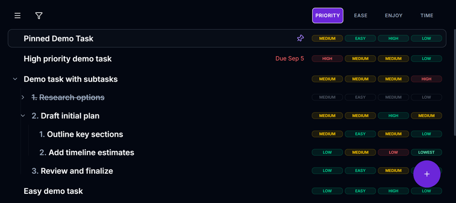
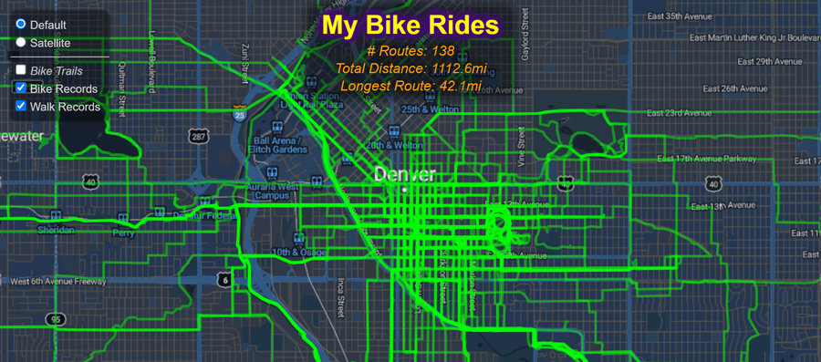
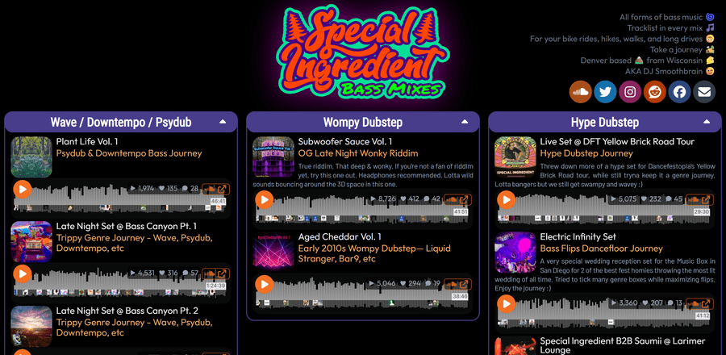
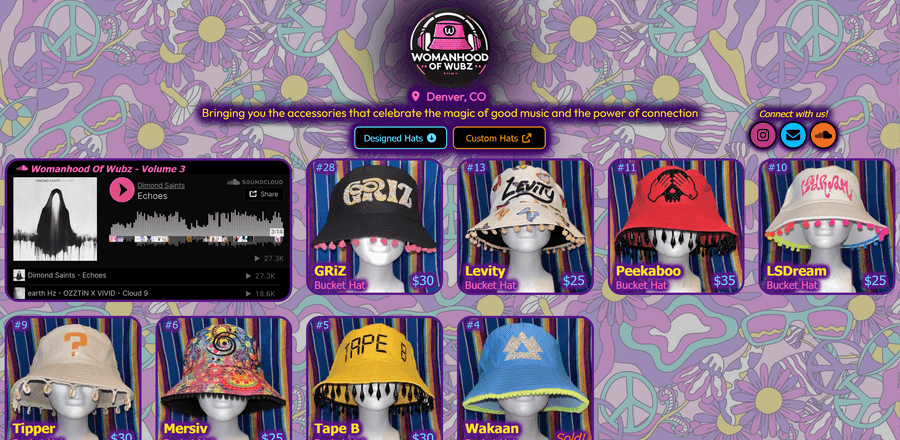

<!-- GENERATED FILE — do not edit directly. Edit src/ and run `pnpm build` -->

  SDET, React developer, TypeScript purist.
   
  9 years writing code and tests, from hardware to web apps.
   
  I build React apps, testing and CI npm packages, and Python DJ tools.
   
  These days I build with AI agents, reviewing and refining every PR until it's code I understand and would write.
   
  Most of what's here started as something I needed and couldn't find.

## 💎&nbsp; Projects &nbsp;💎

  <a href="#react-websites">⚛️&nbsp;React Websites</a>
   · 
  <a href="#testing-ci-tooling">🧪&nbsp;Testing &amp; CI Tooling</a> · 
  <a href="#other-packages">📦&nbsp;Other Packages</a> · 
  <a href="#other-projects">💡&nbsp;Other Projects</a>

<h3 id="react-websites">⚛️⚛️&nbsp;&nbsp;&nbsp;&nbsp;React Websites&nbsp;&nbsp;&nbsp;&nbsp;⚛️⚛️</h3>

  <em>
    <strong>Each runs E2E, accessibility, and Lighthouse tests in CI on every PR.</strong>
  </em>

  &nbsp;&nbsp;&nbsp;<strong><a href="https://taskrankr.com/guest">TaskRankr</a></strong>&nbsp;&nbsp;&nbsp;&nbsp;
   
  My flagship project: after trying 30+ to-do apps, I built my own. An offline-first, cross-device-synced task manager with advanced ranking, nesting, dependencies, customization, and rules. 600+ PRs, each reviewed and refined.&nbsp;<a href="https://github.com/bvandrc/TaskRankr">[repo]</a>
   
  

  &nbsp;&nbsp;&nbsp;<strong><a href="https://bvandrc.github.io/bike-ride-mapper/">Bike Ride Tracker</a></strong>&nbsp;&nbsp;&nbsp;&nbsp;&nbsp;&nbsp;&nbsp;
   
  Interactive map of years of my GPS bike ride data.&nbsp;<a href="https://github.com/bvandrc/bike-ride-mapper">[repo]</a>
   
  

  &nbsp;&nbsp;&nbsp;<strong><a href="https://specialingredientbass.com/">DJ Website</a></strong>&nbsp;&nbsp;&nbsp;&nbsp;&nbsp;&nbsp;&nbsp;
   
  My side hobby. All custom React components, using the SoundCloud API.&nbsp;<a href="https://github.com/bvandrc/specialingredientbass.com">[repo]</a>
   
  

  &nbsp;&nbsp;&nbsp;<strong><a href="https://womanhoodofwubz.neocities.org/">Retail Website</a></strong>&nbsp;&nbsp;&nbsp;&nbsp;&nbsp;&nbsp;&nbsp;
   
  CMS-driven storefront with custom React components, built for a friend.&nbsp;<a href="https://github.com/bvandrc/womanhoodofwubz.com">[repo]</a>
   
  

<h3 id="testing-ci-tooling">🧪🧪&nbsp;&nbsp;&nbsp;&nbsp;Testing &amp; CI Tooling&nbsp;&nbsp;&nbsp;&nbsp;🧪🧪</h3>

  &nbsp;&nbsp;&nbsp;<strong><a href="https://www.npmjs.com/package/lighthouse-audit-utils">lighthouse-audit-utils</a></strong>&nbsp;&nbsp;&nbsp;&nbsp;&nbsp;&nbsp;&nbsp;
   
  Run Lighthouse audits with threshold checks, readable recommendations, report output, and a Playwright fixture.

  &nbsp;&nbsp;&nbsp;<strong><a href="https://github.com/marketplace/actions/pr-diff-line-count">pr-diff-line-count</a></strong>&nbsp;&nbsp;&nbsp;&nbsp;&nbsp;&nbsp;&nbsp;
   
  GitHub Action for accurate PR diff line counts via cloc, split by source, tests, docs, and config.&nbsp;<a href="https://github.com/bvandrc/pr-diff-line-count">[repo]</a>

  &nbsp;&nbsp;&nbsp;<strong><a href="https://github.com/marketplace/actions/detect-deploy">detect-deploy</a></strong>&nbsp;&nbsp;&nbsp;&nbsp;&nbsp;&nbsp;&nbsp;
   
  GitHub Action that polls a URL to detect when a deploy has gone live.&nbsp;<a href="https://github.com/bvandrc/detect-deploy">[repo]</a>

  &nbsp;&nbsp;&nbsp;<strong><a href="https://www.npmjs.com/package/react-component-test-suite">react-component-test-suite</a></strong>&nbsp;&nbsp;&nbsp;&nbsp;&nbsp;&nbsp;&nbsp;
   
  Auto-title Vitest and Jest suites from the React component's name.

  &nbsp;&nbsp;&nbsp;<strong><a href="https://github.com/marketplace/actions/package-json-lint">lint-package-json</a></strong>&nbsp;&nbsp;&nbsp;&nbsp;&nbsp;&nbsp;&nbsp;
   
  GitHub Action that enforces shared package.json lint rules across repos.&nbsp;<a href="https://github.com/bvandrc/lint-package-json">[repo]</a>

  &nbsp;&nbsp;&nbsp;<strong><a href="https://www.npmjs.com/package/glob-sort">glob-sort</a></strong>&nbsp;&nbsp;&nbsp;&nbsp;&nbsp;&nbsp;&nbsp;
   
  Rule-based ordering of nested glob results for test configs.

<h3 id="other-packages">📦📦&nbsp;&nbsp;&nbsp;&nbsp;Other Packages&nbsp;&nbsp;&nbsp;&nbsp;📦📦</h3>

  &nbsp;&nbsp;&nbsp;<strong><a href="https://www.npmjs.com/package/tsx-to-pdf">tsx-to-pdf</a></strong>&nbsp;&nbsp;&nbsp;&nbsp;&nbsp;&nbsp;&nbsp;
   
  JSX + Tailwind to page-exact PDF, with a live-preview dev server.

  &nbsp;&nbsp;&nbsp;<strong><a href="https://www.npmjs.com/package/persistent-logger">persistent-logger</a></strong>&nbsp;&nbsp;&nbsp;&nbsp;&nbsp;&nbsp;&nbsp;
   
  Crash-resilient, localStorage-backed browser diagnostics logging, with optional React hooks.

  &nbsp;&nbsp;&nbsp;<strong><a href="https://www.npmjs.com/package/@bvandrc/react-toolkit">react-toolkit</a></strong>&nbsp;&nbsp;&nbsp;&nbsp;&nbsp;&nbsp;&nbsp;
   
  Generic React hooks and helpers for browser UI behavior.

  &nbsp;&nbsp;&nbsp;<strong><a href="https://pypi.org/project/serato-tools/">serato-tools</a></strong>&nbsp;&nbsp;&nbsp;&nbsp;&nbsp;&nbsp;&nbsp;
   
  Python tools for reading and modifying Serato DJ's tracks, hot cues, waveforms, metadata, crates, and library database.&nbsp;<a href="https://github.com/bvandrc/serato-tools">[repo]</a>

  &nbsp;&nbsp;&nbsp;<strong><a href="https://pypi.org/project/serato-usb-export/">serato-usb-export</a></strong>&nbsp;&nbsp;&nbsp;&nbsp;&nbsp;&nbsp;&nbsp;
   
  Fast, deduplicated USB export tool for Serato DJ.

<h3 id="other-projects">💡💡&nbsp;&nbsp;&nbsp;&nbsp;Other Projects&nbsp;&nbsp;&nbsp;&nbsp;💡💡</h3>

  &nbsp;&nbsp;&nbsp;<strong><a href="https://github.com/bvandrc/SD">spotify-organizer</a></strong>&nbsp;&nbsp;&nbsp;&nbsp;&nbsp;&nbsp;&nbsp;
   
  Python automation for my 11k+ track DJ library utilizing the Spotify and SoundCloud APIs. 
  <em>(private repo)</em>

  &nbsp;&nbsp;&nbsp;<strong><a href="https://github.com/bvandrc/arduino-totem">arduino-totem</a></strong>&nbsp;&nbsp;&nbsp;&nbsp;&nbsp;&nbsp;&nbsp;
   
  Firmware for my LED festival totem, controlled by dials, buttons, and an accelerometer.

## 🌟&nbsp; Skills &nbsp;🌟

<table>
  <tr>
    <td colspan="2" align="center">
      <h3>🖥️🖥️&nbsp;&nbsp;&nbsp;&nbsp;Core Development&nbsp;&nbsp;&nbsp;&nbsp;🖥️🖥️</h3>
    </td>
  </tr>
  <tr>
    <td align="right">
      <em>Languages</em>
    </td>
    <td align="center">
      
      
      
       
      
      
      
    </td>
  </tr>
  <tr>
    <td align="right">
      <em>Dev Tools</em>
    </td>
    <td align="center">
      
      
      
      
    </td>
  </tr>
  <tr>
    <td align="right">
      <em>Libraries</em>
    </td>
    <td align="center">
      
      
      
    </td>
  </tr>
  <tr>
    <td align="right">
      <em>Skills</em>
    </td>
    <td align="center">
      
    </td>
  </tr>
  <tr>
    <td colspan="2" align="center">
      <h3>🧪🧪&nbsp;&nbsp;&nbsp;&nbsp;Testing&nbsp;&nbsp;&nbsp;&nbsp;🧪🧪</h3>
    </td>
  </tr>
  <tr>
    <td align="right">
      <em>E2E</em>
    </td>
    <td align="center">
      
      
      
      
    </td>
  </tr>
  <tr>
    <td align="right">
      <em>Unit</em>
    </td>
    <td align="center">
      
      
      
    </td>
  </tr>
  <tr>
    <td colspan="2" align="center">
      <h3>🛠️🛠️&nbsp;&nbsp;&nbsp;&nbsp;Tools&nbsp;&nbsp;&nbsp;&nbsp;🛠️🛠️</h3>
    </td>
  </tr>
  <tr>
    <td align="right">
      <em>AI</em>
    </td>
    <td align="center">
      
      
      
    </td>
  </tr>
  <tr>
    <td align="right">
      <em>CI / CD</em>
    </td>
    <td align="center">
      
    </td>
  </tr>
  <tr>
    <td align="right">
      <em>
        Project
         
        Mgmt.
      </em>
    </td>
    <td align="center">
      
      
    </td>
  </tr>
  <tr>
    <td colspan="2" align="center">
      <h3>📝📝&nbsp;&nbsp;&nbsp;&nbsp;Other Languages&nbsp;&nbsp;&nbsp;&nbsp;📝📝</h3>
    </td>
  </tr>
  <tr>
    <td align="right">
      <em>Hardware</em>
    </td>
    <td align="center">
      
    </td>
  </tr>
</table>

## 📈&nbsp; Stats &nbsp;📈

<!-- https://github.com/anuraghazra/github-readme-stats -->
 

<!-- https://github.com/DenverCoder1/github-readme-streak-stats -->
<!--  -->

<!-- https://github.com/bvandrc/github-repository-contribution-stats -->
 

<!--   -->

<!-- https://github.com/lowlighter/metrics -->
<!-- TODO: see why this has higher numbers, and contribute fixes to the other repos -->
<!--   -->

<!--  -->

## 🎉&nbsp; Beyond Code &nbsp;🎉

When I'm not coding, you'll find me:

  🎧 DJing 🎧
   
  🚴 Bike Riding to explore Denver 🚴
   
  ⛷️ Hitting the slopes with friends ⛷️
   
  ✈️ Exploring my neighborhood, Colorado, and the world! ✈️
   
  🎬 Checking out good movies 🎬
   
  🎵 Catching live music 🎵

